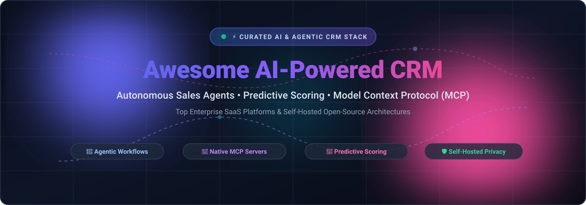

# Awesome AI-Powered CRM Platform 🚀

  

    

  <!-- Badges bar -->
  
  
  
  
  

  

    <b>🌟 Curated directory of AI-native CRM suites, autonomous sales agents, and self-hosted open-source CRM architectures with native Model Context Protocol (MCP) support. 🌟</b>
  

---

## 📑 Table of Contents

- [🌟 Sector Overview & Market Dynamics](#-sector-overview--market-dynamics)
- [🏢 SaaS & Hosted Platforms](#-saas--hosted-platforms)
- [🔓 Open-Source GitHub Projects](#-open-source-github-projects)
- [🛠️ Additional Open-Source & Ecosystem Tools](#️-additional-open-source--ecosystem-tools)
- [🤝 How to Contribute](#-how-to-contribute)
- [💖 Support & Sponsorship](#-support--sponsorship)
- [📈 Star History](#-star-history)
- [⚖️ Disclaimer](#️-disclaimer)

---

## 🌟 Sector Overview & Market Dynamics

The global CRM software market is valued at approximately **$113 billion to $126 billion** (2025–2026), continuing double-digit compounding growth driven by enterprise cloud modernization, sales cycle automation, and autonomous AI agent workflows. 

Structurally, the market exhibits a **barbell dynamic**:
- **Concentrated Enterprise Apex**: Top tech conglomerates (Salesforce, Microsoft, Oracle, SAP) command the high-end enterprise sector with deep multi-cloud integrations and strict security guardrails.
- **Fragmented Long Tail & AI-Native Innovators**: The mid-market, SMB, and developer tiers are highly fragmented among hundreds of specialized SaaS solutions and open-source platforms, ensuring there is no single "winner-take-all" outcome.

---

## 🏢 SaaS & Hosted Platforms

| Platform | Company Size (Valuation / Revenue) | Starting Pricing (Specific Tier) | Free Tier / Free Trial Limits | Key AI Capabilities & Best For |
| :--- | :--- | :--- | :--- | :--- |
| **[Microsoft Dynamics 365 Copilot](https://www.microsoft.com/dynamics-365)** | **$3.87T+ Market Cap** ($331.8B FY26 Revenue) | **$65/user/month** (Sales Professional; $105/user/mo for Sales Enterprise with embedded Copilot; $150/user/mo for Sales Premium) | **30-day free trial** (Full evaluation access, can be extended once by 30 days to 60 days total via admin banner; 0 permanent free users) | Sales Research Agent combines CRM data with Microsoft 365, Teams, Outlook, and SQL context. Best for Microsoft-centric enterprises. |
| **[Salesforce Einstein 1 / Agentforce](https://www.salesforce.com/)** | **~$190B Market Cap** ($41.5B FY26 Revenue) | **$25/user/month** (Starter Suite; Agentforce Sales Pro Suite ~$100/user/mo; standalone Agentforce add-on ~$550/user/mo) | **30-day free trial** (Starter Suite trial supports up to 10 users, 2,000 marketing emails, out-of-the-box AI email drafting; 0 permanent free users) | Autonomous agentic cadences, predictive scoring, trust-layer guardrails, audit tracing, and cross-cloud agent orchestration. Best for large enterprises requiring strict AI governance. |
| **[HubSpot Smart CRM (Breeze)](https://www.hubspot.com/)** | **~$12.8B Market Cap** ($3.7B FY26 Run-rate) | **$15/seat/month** (Starter; Sales Hub Professional at $100/seat/mo includes Breeze agents + $1,500 onboarding) | **Free forever plan** (Strictly capped at **2 users**, **1,000 contact records**, 2,000 marketing emails/mo, 1 pipeline, 10 custom properties; includes Breeze basics) | Breeze Prospecting Agent, Breeze Customer Agent, and automatic lead scoring. Best for SMBs and mid-market teams seeking out-of-the-box AI without enterprise setup overhead. |
| **[Zoho Zia](https://www.zoho.com/crm/)** | **~$12.5B Valuation** (est.) (~$1.5B FY25 Revenue) | **$14/user/month** billed annually ($20/mo monthly for Standard; Zia AI unlocked on Enterprise at $40/user/mo) | **Free forever plan** (Strictly capped at **3 users**, **5,000 records**, 1 GB organization file storage, no API access, 5 custom list views) | Zia Agent Studio for custom knowledge sources and multi-agent workflows, conversational AI, and anomaly detection. Best for Zoho-centric organizations wanting affordable automation. |
| **[Freshworks Freddy AI](https://www.freshworks.com/)** | **~$4.1B Market Cap** (~$904M TTM Revenue) | **$9/user/month** billed annually ($11/mo monthly for Growth; Pro at $39/user/mo, Enterprise at $59/user/mo) | **Free forever plan** (Capped at **3 users**, basic contact/deal management without sales sequences or bulk email SMTP; plus 21-day Pro free trial) | Freddy AI copilot for deal insights, automated email copy generation, and predictive contact scoring. Best for SMBs wanting fast deployment at low cost. |
| **[Pipedrive AI](https://www.pipedrive.com/)** | **~$1.5B Valuation** (~$207M ARR est.) | **$14/seat/month** billed annually ($24/mo monthly for Lite; Premium at $59/seat/mo for AI automations) | **14-day free trial** (Full access to chosen tier including Nova meeting intelligence and native MCP tools, no credit card required; 0 permanent free users) | Nova meeting intelligence, AI deal summaries, email generation, and native MCP server integration on all plans. Best for sales reps focused on visual pipeline management. |
| **[Creatio](https://www.creatio.com/)** | **$1.2B Valuation** (~$210M ARR est.) | **$55/user/month** ($40/user/mo Growth platform base + $15/user/mo Sales Creatio add-on; $10k annual minimum purchase) | **14-day free trial** (Full access to Freedom UI, Studio no-code workflow builder, and AI capabilities without credit card; 0 permanent free users) | Session monitoring, token tracking, audit trails, and evaluation/rollback tools for AI agents. Best for organizations prioritizing no-code adaptability and rigorous AI governance. |
| **[SugarCRM](https://www.sugarcrm.com/)** | **~$500M Valuation** (est.) (~$105M ARR est.) | **$68/user/month** billed annually (Sugar Sell Standard+; Advanced+ at $98/user/mo, Premier+ at $155/user/mo) | **No self-service free trial or free tier** (Requires sales-assisted demo and custom proof-of-concept provisioning; 0 self-serve free days/users) | SugarPredict AI engine for predictive deal scoring, churn analysis, and automated opportunity sentiment tracking. Best for mid-to-large businesses looking for sales cycle automation. |

---

## 🔓 Open-Source GitHub Projects

Sorted in descending order by GitHub stargazer count. Each project features its real-time Stars_Badge linking directly to stargazers.

- ### 1. **[Twenty 2.0](https://github.com/twentyhq/twenty)** 
  - **License**: AGPL-3.0 | **Stack**: TypeScript, React, Node.js, PostgreSQL
  - **Overview**: The most popular open-source Salesforce alternative. Version 2.0 focuses on AI integration, native MCP (Model Context Protocol) connectivity via OAuth, serverless Logic Functions, Docker EKS deployment targets, and GraphQL administration.
  - **AI Capabilities**: Direct MCP endpoint access for LLMs (Claude, Gemini, ChatGPT) with granular authentication.
  - **Best For**: Engineering-first teams desiring a modern TypeScript full-stack CRM with composable developer workflows.

- ### 2. **[Odoo CRM](https://github.com/odoo/odoo)** 
  - **License**: LGPL-3.0 | **Stack**: Python, JavaScript (OWL), PostgreSQL
  - **Overview**: The world's most widely adopted open-source ERP/CRM suite. Powers end-to-end business operations across customer relationships, inventory, automated billing, and omnichannel marketing.
  - **AI Capabilities**: Automated lead enrichment, AI communication draft assistants, and intelligent routing.
  - **Best For**: Mid-market and enterprise organizations seeking a unified CRM wired into accounting and supply chain operations.

- ### 3. **[ERPNext](https://github.com/frappe/erpnext)** 
  - **License**: GPL-3.0 | **Stack**: Python (Frappe Framework), MariaDB, Redis, Vue.js
  - **Overview**: Comprehensive open-source business management software with full CRM, lead waterfall pipelines, communication histories, quotations, and deal progression workflows.
  - **AI Capabilities**: Frappe AI integration for query generation, automated email summarizing, and pipeline health analytics.
  - **Best For**: Businesses wanting a 100% free and open-source CRM integrated with complete business ERP modules.

- ### 4. **[Chatwoot](https://github.com/chatwoot/chatwoot)** 
  - **License**: AGPL-3.0 | **Stack**: Ruby on Rails, Vue.js, PostgreSQL
  - **Overview**: Open-source customer engagement platform and conversational CRM alternative to Intercom and Zendesk. Aggregates WhatsApp, Twitter, Facebook, Email, and Live Chat into an omnichannel inbox.
  - **AI Capabilities**: Captain AI assistant for conversational summaries, intent detection, response suggestions, and automated customer routing.
  - **Best For**: Support and sales teams requiring real-time conversation-first CRM with omni-channel messaging.

- ### 5. **[Krayin CRM](https://github.com/krayin/laravel-crm)** 
  - **License**: MIT | **Stack**: PHP (Laravel), Vue.js, MySQL
  - **Overview**: High-performance, lightweight Laravel-native CRM built for SMEs. Offers intuitive lead management, custom attributes, Kanban boards, and extensible modular architecture.
  - **AI Capabilities**: Extensible API-driven architecture ready for external LLM pipeline integrations.
  - **Best For**: Laravel developers needing an enterprise-grade, permissively licensed CRM to customize and extend.

- ### 6. **[Mautic](https://github.com/mautic/mautic)** 
  - **License**: GPL-3.0 | **Stack**: PHP (Symfony), MySQL
  - **Overview**: The leading open-source marketing automation and lead-scoring CRM platform. Enables automated multi-channel nurturing campaigns, behavioral tracking, and dynamic customer segmentations.
  - **AI Capabilities**: Predictive audience segmentation, content personalization, and automated campaign triggering.
  - **Best For**: Inbound marketing, growth marketers, and lead qualification teams desiring self-hosted marketing CRM power.

- ### 7. **[SuiteCRM](https://github.com/salesagility/SuiteCRM)** 
  - **License**: AGPL-3.0 | **Stack**: PHP, Smarty, MySQL / MariaDB
  - **Overview**: The open-source evolution of SugarCRM. Highly battle-tested with millions of users globally, featuring granular role-based security suites, process workflow engines, and reporting dashboards.
  - **AI Capabilities**: REST API ecosystem allowing external agentic and LLM tooling integrations.
  - **Best For**: Organizations with mature enterprise sales workflows requiring on-premise data control and compliance.

- ### 8. **[Erxes](https://github.com/erxes/erxes)** 
  - **License**: AGPL-3.0 | **Stack**: TypeScript, Node.js, React, MongoDB
  - **Overview**: Open-source Experience Operating System (XOS) combining CRM, sales pipelines, marketing automation, service desk, and team collaboration into a single modular suite.
  - **AI Capabilities**: Automated conversational bots, messaging bots, and contact lifecycle intelligence.
  - **Best For**: Modern product and growth teams needing marketing, sales, and service tools bundled in a single TypeScript platform.

- ### 9. **[EspoCRM](https://github.com/espocrm/espocrm)** 
  - **License**: AGPL-3.0 | **Stack**: PHP, MySQL / PostgreSQL, Backbone.js
  - **Overview**: Ultra-fast single-page application (SPA) CRM with an extensive administration layout editor, configurable entity relationships, OIDC/LDAP authentication, and complete REST APIs.
  - **AI Capabilities**: Integrates cleanly with external OpenAI/Anthropic pipelines through webhooks and custom API extensions.
  - **Best For**: Teams needing an ultra-responsive, cleanly architected self-hosted CRM with flexible custom schemas.

- ### 10. **[Relaticle](https://github.com/relaticle/relaticle)** 
  - **License**: AGPL-3.0 | **Stack**: PHP (Laravel), Filament, PostgreSQL
  - **Overview**: The most AI-native open-source CRM, featuring **37 built-in Model Context Protocol (MCP) tools** and embedded AI chat. Allows Claude, ChatGPT, or local LLMs to manipulate CRM entities through strict permissions.
  - **AI Capabilities**: Embedded AI chat with voice support, 37 MCP server tools, 5-second undo approval cards for destructive actions, and entity relationship graphing.
  - **Best For**: Teams wanting a production-grade AI-first CRM where autonomous agents are first-class citizens.

- ### 11. **[NextCRM](https://github.com/pdovhomilja/nextcrm-app)** 
  - **License**: MIT | **Stack**: Next.js 14, TypeScript, Prisma, PostgreSQL (`pgvector`), Tailwind CSS
  - **Overview**: Modern full-stack Next.js AI-native CRM featuring vector search embeddings and native MCP server endpoints with over 100 exposed tools.
  - **AI Capabilities**: Built-in `pgvector` semantic customer search, E2B sandboxed agent workflows, and native HTTP/SSE MCP endpoints.
  - **Best For**: Next.js developers and modern startups building custom AI agent sales architectures.

---

## 🛠️ Additional Open-Source & Ecosystem Tools

- **[HermitCRM](https://pypi.org/project/hermitcrm/)**: File-based minimalist CRM where every record is a Markdown file in a Git repo. Features "Ask Hermit" LLM querying and an MCP server with 17 tools.
- **[Enrichment-Kit](https://github.com/enrichment-kit/enrichment-kit)**: Open-source waterfall data enrichment engine (Clay alternative) for high-efficiency lead qualification.
- **[Twenty MCP Server (`KonstiDoll/twenty-crm-mcp-server`)](https://github.com/KonstiDoll/twenty-crm-mcp-server)**: Community Model Context Protocol server exposing Twenty CRM schemas to Claude and agentic runtimes.

---

## 🤝 How to Contribute

Contributions are warmly welcomed! Help make this curated repository the most comprehensive resource for AI-driven customer relationship management.

1. 🍴 **Fork** the repository.
2. 🌿 Create a descriptive feature branch: `git checkout -b feature/add-new-crm`.
3. 📝 Add or update entries following the established format and tables.
4. ⭐ Keep descriptions factual, objective, and link directly to official documentation or source repos.
5. 🚀 Submit a PR with a concise summary of changes.

---

## 💖 Support & Sponsorship

If you find this repository valuable for your research, team, or open-source stack, please consider supporting the project!

- ⭐ **Star the repo**: Spread the word to help other developers discover AI CRM tools.
- 🍴 **Fork & Share**: Share with sales ops, founders, and engineers building agentic workflows.
- ☕ **Buy me a coffee**: Support ongoing curation, benchmarking, and updates via the [GitHub Sponsors Dashboard](https://github.com/sponsors/ishandutta2007).

  

---

## 📈 Star History

---

## ⚖️ Disclaimer

- This is a community-curated list intended for research and informational purposes. No product placement or commercial endorsement is implied.
- AI systems interacting with customer databases and PII (Personally Identifiable Information) must comply with local privacy regulations (GDPR, CCPA, HIPAA). Verify access control layers, audit tracing, and human-in-the-loop safeguards before deploying autonomous agents in production.
- Commercial pricing and free-tier quotas fluctuate; verify current licensing terms directly with respective vendors.
